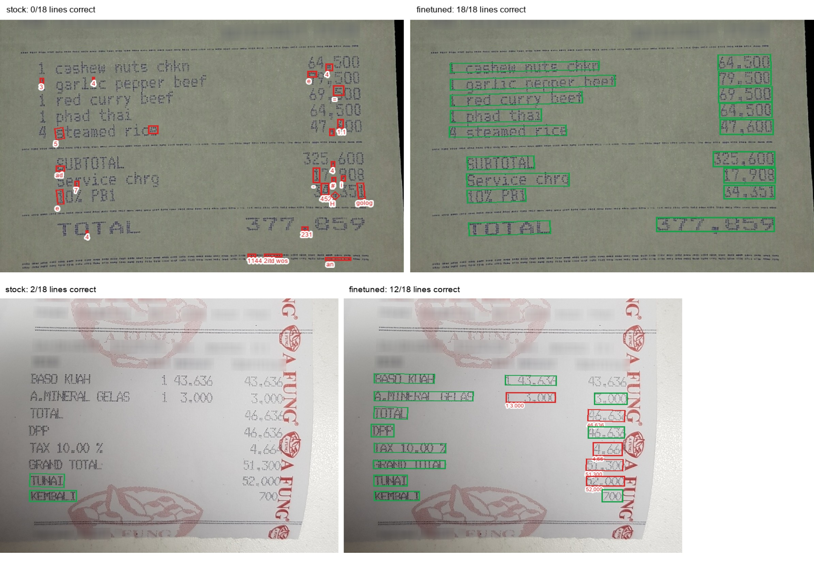

# 在自己的数据上微调 PaddleOCR PP-OCRv6

[English](README.md) | [简体中文](README.zh-CN.md)

[](https://colab.research.google.com/github/Dmitry543/Fine-Tuning-OCR-Model-with-PaddleOCR/blob/main/finetune.ipynb)


[](https://github.com/Dmitry543/Fine-Tuning-OCR-Model-with-PaddleOCR/actions/workflows/tests.yml)

用你自己的数据微调 PP-OCRv6 文本检测和识别模型，并量化验证效果是否真的提升。一条命令完成全部流程：准备数据、评测官方模型、训练、导出、再次评测。

## 效果

PP-OCRv6_small 在 [CORD](https://huggingface.co/datasets/naver-clova-ix/cord-v2) 小票数据集（800 张训练图）上微调，在 100 张独立测试图上评测：

| 指标 | 官方模型 | 微调后 | 变化 |
|---|---|---|---|
| **端到端 F1**（框和文字都正确） | 79.1% | **88.2%** | +9.1 pt |
| 检测 F1 | 89.7% | **95.8%** | +6.1 pt |
| 检测精确率 / 召回率 | 87.0% / 92.6% | **93.9% / 97.7%** | +6.9 / +5.1 pt |
| 识别准确率（1,555 行） | 90.2% | **94.5%** | +4.3 pt |
| 字符错误率 | 1.79% | **1.10%** | −38% |
| 速度（T4，每张小票） | 0.14 s | 0.14 s | 模型大小不变 |

<p align="center"></p>
<p align="center"><sub>提升最大的两张测试小票。左：官方模型。右：微调后。绿色：框和文字都正确。红色：错误，下方为模型识别出的文字。官方检测模型会把点阵打印的文字拆成单个的点。</sub></p>

以上为单次训练的结果。在免费的 Colab T4 上训练耗时 54 分钟（检测 20 轮，30 分钟；识别 10 轮，24 分钟）；包括环境安装和评测在内，整个 notebook 约 1.5 小时。识别模型在最后一轮时验证集准确率仍在上升，在你的数据上可以适当增加训练轮数。同一模型在 Apple M2 CPU 上评测，结果相差不超过 0.1 个百分点（每张小票 1.6 秒）。原始结果：[`results/cord/`](results/cord)。

### PaddleOCR-VL-1.6 + LoRA

同样的 1,555 行测试数据，用 PaddleOCR-VL-1.6（0.9B 视觉语言模型）识别，对比在 T4 上 21 分钟 LoRA 微调前后的结果（[说明](docs/paddleocr-vl.md)，[notebook](finetune_vl.ipynb)）：

| 文本行识别 | 准确率 | 字符错误率 | 每行耗时（T4） |
|---|---|---|---|
| PaddleOCR-VL-1.6，官方 | 83.4% | 12.9% | 932 ms |
| PaddleOCR-VL-1.6 + LoRA | 90.8% | 4.2% | 874 ms |
| PP-OCRv6_small，官方 | 90.2% | 1.8% | 9 ms |
| PP-OCRv6_small，微调后 | **94.5%** | **1.1%** | **8 ms** |

LoRA 让 VL 模型的错误减少了三分之二，但在小票文本行上，微调后的 PP-OCRv6 识别模型仍然更准确，速度快约 100 倍。

## 快速开始

**Colab（免费 GPU）：** 打开上方的 notebook，运行全部单元格。

**本地运行**（Linux + NVIDIA GPU；任何机器都可以用 CPU 做冒烟测试）：

```bash
git clone https://github.com/Dmitry543/Fine-Tuning-OCR-Model-with-PaddleOCR.git
cd Fine-Tuning-OCR-Model-with-PaddleOCR
python3 -m venv .venv && source .venv/bin/activate

bash setup.sh --gpu     # PaddlePaddle 3.3.1、PaddleOCR 3.7.0、PP-OCRv6 预训练权重
bash finetune.sh        # CORD：下载、基线评测、训练、导出、对比
```

对比表保存在 `results/cord/comparison.md`，模型保存在 `output/inference/`。

## 使用自己的数据

用 [PPOCRLabel](https://github.com/PFCCLab/PPOCRLabel) 标注图片，然后：

```bash
python tools/prepare_data.py ppocrlabel --input path/to/labelled_folder --out data/mydata
DATA=data/mydata bash finetune.sh
```

标注规范、标签格式、字典和其他数据集见 [docs/custom-data.md](docs/custom-data.md)（英文）。

## 使用微调后的模型

```python
from paddleocr import PaddleOCR

ocr = PaddleOCR(
    text_detection_model_name="PP-OCRv6_small_det", text_detection_model_dir="output/inference/det",
    text_recognition_model_name="PP-OCRv6_small_rec", text_recognition_model_dir="output/inference/rec",
    use_doc_orientation_classify=False, use_doc_unwarping=False, use_textline_orientation=False,
)
for res in ocr.predict("receipt.jpg"):
    print(res["rec_texts"])
```

**ONNX**（推理时用 ONNX Runtime 代替 PaddlePaddle）：

```bash
paddlex --install paddle2onnx     # 需要 Python 3.12 或更低版本，目前没有 3.13 的安装包
python tools/export_onnx.py output/inference/det output/inference/rec   # -> output/onnx/{det,rec}
python tools/evaluate.py --name onnx --det output/onnx/det --rec output/onnx/rec --engine onnxruntime
```

加载方式同上，模型路径改为 `output/onnx/...` 并加上 `engine="onnxruntime"`。在 CORD 测试集上，ONNX 模型的各项指标与 Paddle 模型完全一致，在 Apple M2 CPU 上快 4.5 倍（每张小票 0.36 秒 vs 1.63 秒）。PaddlePaddle 3.3 有两处细节会导致转换失败，`finetune.sh` 和 `tools/export_onnx.py` 已经处理（见[常见问题](docs/troubleshooting.md)）。

**演示：** `pip install gradio && python demo/app.py`，上传任意图片即可并排对比官方模型和微调模型。

## 评测方法

`tools/evaluate.py` 使用与实际部署相同的 PaddleOCR 3.x 推理代码：

| 指标 | 含义 |
|---|---|
| 检测 F1 | 预测的文本行框与标注框按 IoU ≥ 0.5 一对一匹配 |
| 识别准确率 | 在标注的文本行裁剪图上文字完全正确的比例（不受检测误差影响） |
| 字符错误率 | 同一批裁剪图上的编辑距离 / 标注长度 |
| 端到端 F1 | 框匹配**且**文字完全正确才算正确 |

文字比较忽略空格（CORD 写作 `( L )`，模型输出 `(L)`），大小写和标点都计入。标注为不可读的区域不参与评测。模型选择只用验证集，测试集只用于报告上面的数字。

## 说明

- 训练需要 NVIDIA GPU。PaddlePaddle 不支持 Apple 芯片 GPU，Mac 上请用 Colab 训练；数据准备、评测、ONNX 导出和演示在 CPU 上都可以运行。
- 版本已固定（PaddlePaddle 3.3.1、PaddleOCR v3.7.0），因为 PaddleOCR 的训练配置和推理 API 在不同版本之间会变化。
- 常见问题：[docs/troubleshooting.md](docs/troubleshooting.md)（英文）。

## 数据与许可

代码：[Apache-2.0](LICENSE)。CORD 数据集 © NAVER Clova，[CC BY 4.0](https://creativecommons.org/licenses/by/4.0/)；`demo/examples/` 和 `docs/assets/` 中的小票图片来自该数据集。
